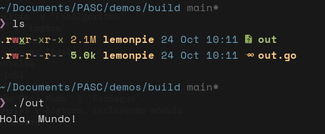
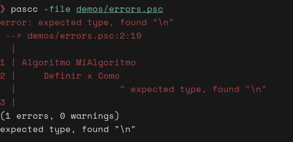
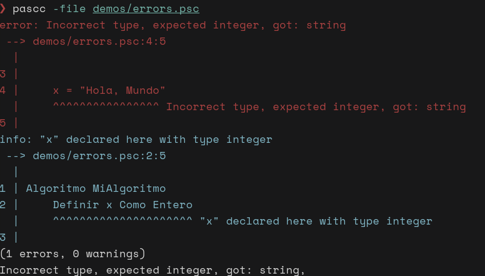
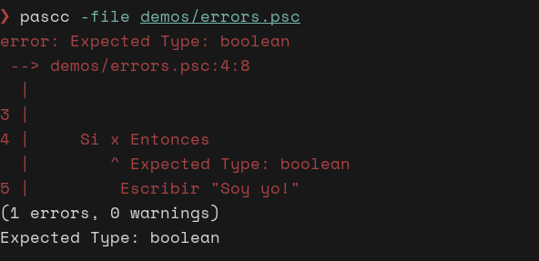
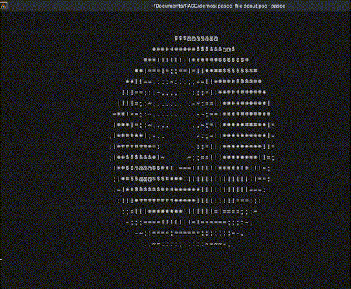

<div align="center">


# `PASC`

**Compilador experimental de pseudocódigo PSeInt**

[](https://go.dev/)
[](https://pseint.sourceforge.net/)
[](#requisitos)

</div>

`pasc` es un compilador y analizador que busca implementar el lenguaje de PSeInt. Es una herramienta tanto de ejecución como de análisis de código, que toma un archivo `.psc` y lo traduce a un binario nativo mediante el compilador de Go. Gracias a esto, `pasc` deja ejecutar un programa escrito en PSeInt sin necesidad de descargar el programa del todo, y además, ofrece una significativa mejora de rendimiento.

> [!IMPORTANT]
> El proyecto sigue en etapa de desarrollo. Ya puede ejecutar programas útiles, pero todavía no implementa todo el lenguaje de PSeInt ni debe considerarse compatible al 100 %.

## Ventajas

- **Compilación real:** El pseudocódigo se transforma en Go y después en un ejecutable que puede ser ejecutado en otras computadoras de manera nativa.

- **Errores fáciles de ubicar:** Sistema moderno de diagnósticos, muestra el archivo, la línea, la columna, el fragmento afectado y un resumen de errores y advertencias.

- **Análisis a tiempo de compilación:** Valida operaciones y asignaciones antes de generar el programa, con soporte para conversiones numéricas seguras.


- **Sintaxis familiar:** Implementa la flexibilidad del lenguaje de PSeInt.
- **Rápidez:** Al compilarse de manera nativa, `pasc` ofrece una mejora de rendimiento significativa contra PSeInt.


(Esto es una dona corriendo a tiempo real en codigo de pseint compilado por `pasc`, deberías probar la [demo](demos/donut.psc), puntos extra si la pruebas en PSeInt vs `pasc`)
- **Extensible y modular:** Posee una arquitectura mucho más moderna que permite facilmente extender las capacidades del compilador.

## Funcionalidades disponibles

Actualmente se soportan:

- Programas delimitados por `Algoritmo` y `FinAlgoritmo`.
- Tipos `Entero`, `Real`, `Cadena` y `Logico`.
- Declaraciones explícitas y asignaciones.
- Literales numéricos, cadenas y valores lógicos.
- `Escribir`, `Leer` y `Borrar Pantalla`.
- Condicionales `Si`, `SiNo` y `FinSi`.
- Ciclos `Mientras ... Hacer` y `FinMientras`.
- Selección con `Segun`, casos, `De Otro Modo` y `FinSegun`.
- Operadores aritméticos, relacionales y lógicos, incluyendo módulo.
- Paréntesis y precedencia de operadores.

## Requisitos

- [Go 1.25 o posterior](https://go.dev/dl/).
- Git, únicamente si vas a clonar el repositorio.
- (Opcional pero recomendado) [Just] para correr los comandos

El compilador invoca a Go internamente para construir el programa generado, por lo que `go` debe estar disponible en el `PATH` incluso después de compilar esta herramienta. (Mejora que se debe hacer)

**No se necesita Go para ejecutar el programa ya una vez compilado**

## Instalación

Clona el repositorio y compila la herramienta:

```bash
git clone https://github.com/sea2horses/pasc.git
cd pasc
go build
```

También puedes usarla directamente desde el código fuente con `go run .`.

Para instalar la herramienta puedes usar `go install` en la carpeta del repo, y de esa manera obtendras acceso al comando `pascc`.

## Uso

Ejecuta el compilador indicando un archivo `.psc` con `-file`:

```bash
./pascc -file demos/hello_world.psc
```

(En el caso de windows, usar `pascc.exe`)

O, sin construir primero el compilador:

```bash
go run . -file demos/hello_world.psc
```

Por el momento, cada ejecución realiza todo el proceso:

1. Lee y valida el pseudocódigo.
2. Genera `build/out.go`.
3. Compila el ejecutable `build/out` (`build/out.exe` en Windows).
4. Ejecuta el binario automáticamente.

### Ejemplo

Crea un archivo llamado `mayoria_edad.psc`:

```text
Algoritmo MayoriaDeEdad
    Definir edad Como Entero

    Escribir "¿Cuántos años tienes?"
    Leer edad

    Si edad >= 18 Entonces
        Escribir "Eres mayor de edad"
    SiNo
        Escribir "Eres menor de edad"
    FinSi
FinAlgoritmo
```

Compílalo y ejecútalo:

```bash
pascc -file mayoria_edad.psc
```

### Información de depuración

Usa `-debug` para ver las etapas internas, como los tokens, el AST, el árbol tipado y el código Go generado:

```bash
pascc -debug -file demos/operations.psc
```

## Estado del proyecto

PSeInt es un lenguaje extremadamente raro, con bastantes cosas "interesantes". Por lo que aun faltan muchos comportamientos por replicar!

Actualmente falta:

- Redimensionar
- Subprocesos, funciones y retorno de valores.
- Sintaxis Flexible
- Aliases como `Proceso` o `:=`
- El ciclo `Para Cada`
- El operador de potencia `^`
- Funciones como `Subcadena`
- Modo no-scope (porque PSeInt por alguna razón no tiene scopes??)
- Perfiles
- Arreglos en índice 1
- Repetir

## Probar los ejemplos

El directorio `demos` contiene programas para probar entrada/salida, operaciones, condicionales, ciclos y `Segun`. Por ejemplo:

```bash
go run . -file demos/operations.psc
go run . -file demos/ages.psc
go run . -file demos/switch.psc
```

Para comprobar que todos los paquetes compilan:

```bash
go test ./...
```

Actualmente no hay casos de prueba automatizados; este comando funciona como comprobación de compilación hasta que se incorpore la suite de pruebas.

## Contribuciones

Las contribuciones son bienvenidas, especialmente para ampliar la sintaxis compatible, mejorar los diagnósticos y añadir pruebas. Antes de hacer un cambio grande, conviene abrir un issue para acordar el alcance y evitar implementaciones duplicadas.

El uso de IA está aceptado con **moderación**.
