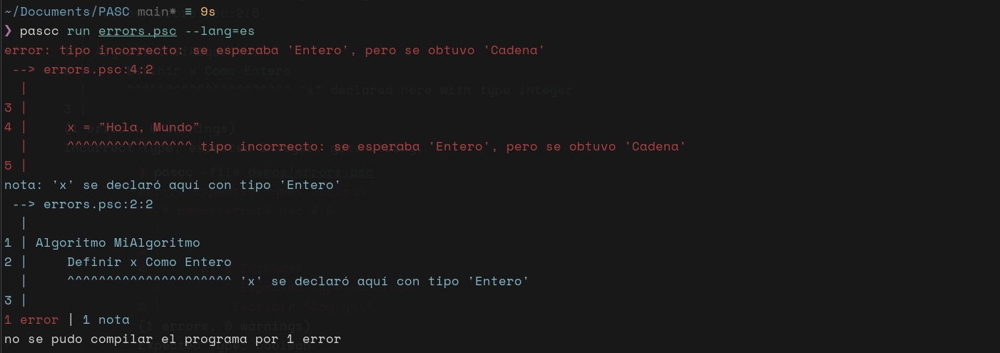
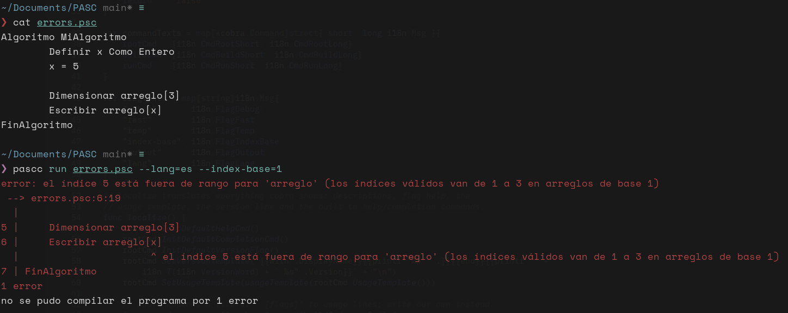
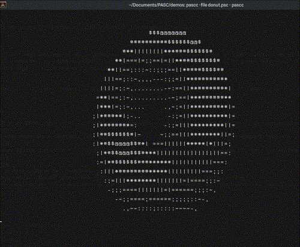

<div align="center">


# `pascc`

**PSeInt Ahead-of-Time Source Code Compiler**

Compilador experimental de pseudocódigo PSeInt

[](https://go.dev/)
[](https://pseint.sourceforge.net/)
[](#requisitos)
[](#compatibilidad-con-programas-reales)

</div>

`pascc` es un compilador y analizador experimental para el lenguaje de PSeInt. Analiza un archivo `.psc`, genera código Go y utiliza la herramienta de Go para crear un ejecutable nativo. La interfaz de línea de comandos está organizada con Cobra y ofrece cuatro comandos: `run` para compilar y ejecutar temporalmente, `build` para conservar el ejecutable, `fmt` para dar formato al código y `highlight` para mostrarlo con resaltado de sintaxis.

> [!IMPORTANT]
> El proyecto sigue en desarrollo. Ya puede ejecutar programas útiles, pero todavía no implementa todo el lenguaje de PSeInt ni debe considerarse compatible al 100 %.

## Ventajas

<div align="center">

- **Compilación nativa:** El pseudocódigo se transforma en Go y después en un ejecutable nativo.

- **Errores fáciles de ubicar:** Los diagnósticos muestran el archivo, la línea, la columna, el fragmento afectado y un resumen de errores y advertencias.

- **Análisis a tiempo de compilación:** Valida operaciones y asignaciones antes de generar el programa, con soporte para conversiones numéricas seguras.


- **Sintaxis familiar:** Implementa la sintaxis de PSeInt.
- **Rápidez:** El código generado se compila a un ejecutable nativo.<br>


La dona animada es un programa de PSeInt compilado con `pascc`: [ver demo](demos/donut.psc).
- **Formateador integrado:** `pascc fmt` corrige la sangría, los espacios y las mayúsculas de las palabras clave sin cambiar el significado del programa, y con `--check` sirve para verificar el formato en CI (ver [Dar formato al código](#dar-formato-al-código)).
- **Resaltado de sintaxis:** `pascc highlight` muestra el código con colores en la terminal o lo exporta como una página HTML, incluso si el programa tiene errores (ver [Resaltado de sintaxis](#resaltado-de-sintaxis)).
- **Arquitectura modular:** El analizador, el generador, el runtime y los comandos están organizados en paquetes separados.

</div>

## Funcionalidades disponibles

Actualmente se soportan:

- Programas delimitados por `Algoritmo` y `FinAlgoritmo`.
- Tipos `Entero`, `Real`, `Cadena` y `Logico`.
- Declaraciones explícitas y asignaciones.
- Literales numéricos, cadenas y valores lógicos.
- `Escribir`, `Leer` y `Borrar Pantalla`.
- Condicionales `Si`, `SiNo` y `FinSi`.
- Ciclos `Mientras ... Hacer` y `FinMientras`.
- Selección con `Segun`, casos, `De Otro Modo` y `FinSegun`.
- Operadores aritméticos, relacionales y lógicos, incluyendo módulo.
- Paréntesis y precedencia de operadores.
- Arreglos con `Dimensionar` y `Redimensionar`, en base 0 o base 1 (ver [Base de los arreglos](#base-de-los-arreglos)).
- Ciclos `Para Cada elemento De arreglo`, donde la variable es una referencia al elemento.
- Expresiones en lenguaje coloquial: `x es par`, `es impar`, `es positivo`, `es cero`, `es mayor que`, `es menor o igual que`, `es distinto de`, `es divisible por`, `es multiplo de`, etc.
- Verificaciones en tiempo de compilación: conversiones de real a entero sin `Redon()`/`Trunc()` e índices fuera de rango.

## Requisitos

- [Go 1.25 o posterior](https://go.dev/dl/).
- Git, únicamente si vas a clonar el repositorio.
- [Just](https://just.systems/) es opcional y facilita algunos comandos de desarrollo.

Para compilar programas `.psc`, `pascc` ejecuta `go build`, así que Go debe estar disponible en el `PATH`. Los ejecutables creados con `build` se ejecutan sin necesitar Go.

## Instalación

Clona el repositorio y compila la herramienta:

```bash
git clone https://github.com/sea2horses/pascc.git
cd pascc
go build -o pascc .
```

En Windows, el ejecutable se llamará `pascc.exe`. También puedes instalarlo en el directorio de binarios de Go:

```bash
go install .
```

Si ese directorio está en tu `PATH`, podrás invocar `pascc` desde cualquier ubicación. Para usarlo sin compilar la herramienta primero, ejecuta los comandos con `go run .`.

## Uso

### Ejecutar un programa

`run` compila el archivo en un directorio temporal, ejecuta el resultado y elimina los archivos temporales al terminar:

```bash
./pascc run demos/hello_world.psc
```

O desde el código fuente:

```bash
go run . run demos/hello_world.psc
```

### Construir un ejecutable

`build` conserva el ejecutable y el código Go generado en `build/` por defecto. El nombre del ejecutable se toma del archivo `.psc`:

```bash
./pascc build demos/hello_world.psc
```

El resultado queda en `build/hello_world` (`build/hello_world.exe` en Windows), junto con `build/hello_world.go`. Puedes elegir otro directorio con `-o` o `--output`:

```bash
./pascc build -o dist demos/hello_world.psc
```

También puedes usar `--fast` para compilar sin las dependencias de terminal. En ese modo, `Esperar Tecla` muestra un mensaje y espera a que el usuario presione Enter:

```bash
./pascc build --fast demos/hello_world.psc
```

En los ejemplos anteriores, reemplaza `./pascc` por `pascc.exe` en Windows, o usa `go run .` para ejecutar desde el código fuente.

### Dar formato al código

`fmt` corrige la sangría, los espacios entre operadores y las mayúsculas de las palabras clave (`finsi` pasa a `FinSi`) sin cambiar el significado del programa. Conserva los comentarios, las líneas y la forma en que escribiste cada instrucción (`Fin Funcion` o `FinFuncion`, `<-` o `=`):

```bash
./pascc fmt programa.psc               # muestra el resultado sin modificar el archivo
./pascc fmt -w programa.psc demos/     # sobrescribe los archivos (las carpetas se recorren)
./pascc fmt --check demos/             # lista los archivos sin formato y falla si hay alguno
./pascc fmt -w --indent 4 programa.psc # sangría de 4 espacios en lugar de tabuladores
```

Los archivos con errores de sintaxis no se modifican: se muestran sus diagnósticos. Se respeta la codificación del archivo (UTF-8 o Windows-1252) y sus saltos de línea.

### Resaltado de sintaxis

`highlight` (o su alias `hl`) muestra programas con colores en la terminal, o genera una página HTML lista para compartir. Distingue palabras clave, operadores, tipos, funciones definidas en el archivo, funciones predefinidas (`Raiz`, `Azar`, `PI`…), cadenas, números, valores lógicos y comentarios. También funciona con programas que tienen errores: lo que no se puede leer se subraya en rojo.

```bash
./pascc hl programa.psc                         # colores en la terminal
./pascc hl --color always programa.psc | less -R
./pascc hl --format html demos/ > demos.html    # página HTML con todos los ejemplos
```

Con `--color auto` (predeterminado) los colores se desactivan si la salida no es una terminal o si está definida la variable `NO_COLOR`.

### Base de los arreglos

PSeInt permite que los arreglos empiecen en 0 o en 1 según el perfil. Tanto `build` como `run` aceptan `--index-base`:

```bash
./pascc run --index-base 1 programa.psc   # v[1] es el primer elemento
./pascc run --index-base 0 programa.psc   # v[0] es el primer elemento
./pascc run programa.psc                  # auto (predeterminado)
```

En modo `auto`, el analizador deduce la base a partir de cómo se indexan los arreglos: un índice que puede valer `0` o un ciclo que llega hasta `n - 1` indica base 0; un índice que alcanza el tamaño del arreglo (`v[n]` con `Dimensionar v[n]`) o un ciclo `Para i <- 1 Hasta n` indica base 1. Si no hay indicios, se usa base 0, y si los indicios se contradicen se muestra una advertencia.

Con la base ya decidida, el compilador evalúa expresiones constantes y rangos de ciclos para detectar antes de ejecutar:

- índices constantes fuera de rango (error) y ciclos que se salen del arreglo (advertencia);
- dimensiones menores que 1 (error);
- conversiones de real a entero: un valor constante con decimales es un error (`k = 7 / 2`), y un valor que no se puede demostrar entero genera una advertencia que sugiere usar `Redon()` (o su alias `Redondear()`) o `Trunc()`.

### Diagnósticos en JSON

Para integrar `pascc` con editores u otras herramientas, `build`, `run` y `fmt` aceptan `--diagnostic-format json`. En ese modo cada diagnóstico se escribe en stderr como un objeto JSON por línea ([JSON Lines](https://jsonlines.org/)), sin colores ni extractos de código:

```bash
./pascc build --diagnostic-format json programa.psc
```

```json
{"level":"error","message":"tipo incorrecto: se esperaba 'Entero', pero se obtuvo 'Cadena'","file":"programa.psc","span":{"start":{"line":3,"column":2,"offset":36},"end":{"line":3,"column":12,"offset":46}}}
{"level":"info","message":"'z' se declaró aquí con tipo 'Entero'","file":"programa.psc","span":{"start":{"line":2,"column":2,"offset":13},"end":{"line":2,"column":23,"offset":34}}}
{"level":"error","message":"no se pudo compilar el programa por 1 error"}
```

- `level` es `error`, `warning` o `info` (siempre en inglés); `message` sigue el idioma de `--lang`.
- `line` y `column` empiezan en 1, `offset` en 0; columnas y offsets cuentan caracteres Unicode, y `end` es exclusivo.
- Los errores que no vienen del código fuente (archivo inexistente, fallo al compilar, etc.) no tienen `file` ni `span`.
- El código de salida es distinto de 0 si hubo errores.

### Depuración

Tanto `build` como `run` aceptan `--debug` para mostrar información de las etapas del compilador, incluidos tokens, AST, árbol tipado y código Go generado:

```bash
./pascc run --debug demos/operations.psc
./pascc build --debug demos/operations.psc
```

Consulta la ayuda integrada para ver opciones y comandos:

```bash
pascc --help
pascc run --help
pascc build --help
pascc fmt --help
pascc highlight --help
```

### Ejemplo

Crea un archivo llamado `mayoria_edad.psc`:

```text
Algoritmo MayoriaDeEdad
    Definir edad Como Entero

    Escribir "¿Cuántos años tienes?"
    Leer edad

    Si edad >= 18 Entonces
        Escribir "Eres mayor de edad"
    SiNo
        Escribir "Eres menor de edad"
    FinSi
FinAlgoritmo
```

Ejecútalo directamente o crea un binario:

```bash
pascc run mayoria_edad.psc
pascc build mayoria_edad.psc
```

## Compatibilidad con programas reales

Para medir la compatibilidad, `pascc` se probó contra los **18 repositorios más populares de GitHub con el tema [`pseint`](https://github.com/topics/pseint)**: **531 programas `.psc`** escritos por estudiantes y docentes, sin modificar, con codificaciones mixtas (UTF-8 y Windows-1252), estilos de sintaxis distintos y arreglos en base 0 y en base 1.

| Resultado | Programas | |
| --- | ---: | ---: |
| Compilan a un ejecutable nativo | **520 / 531** | **97.9 %** |
| Compilan, contando solo los programas válidos | **520 / 520** | **100 %** |
| Rechazados por errores reales en el código fuente | 11 | |
| Base de arreglos deducida automáticamente como 1 | 40 | |

Los 11 programas rechazados tienen errores reales que PSeInt también rechaza: archivos incompletos, plantillas sin rellenar, comillas que no cierran, `Definir a, b, Como Entero`, etc. En todos los casos `pascc` señala el archivo, la línea y la columna del problema.

**Ejecución.** Cada ejecutable se corrió respondiendo `3` a todas las lecturas. Además de los programas que terminan normalmente, se revisaron a mano todos los que no lo hicieron: **ninguno de los 520 falla por una limitación del compilador**. Todos esos casos se explican por la entrada sintética (menús que nunca reciben la opción de salida, esperas con `Esperar`) o por errores del propio programa: leer fuera de una cadena con `Subcadena`, guardar decimales en una variable `Entero` o ciclos infinitos.

**Deducción de la base de arreglos.** Con la detección automática de base 0 o base 1, **35 programas que antes fallaban en tiempo de ejecución ahora funcionan** y ninguno empeoró. Esos programas recorren arreglos con `Para i <- 1 Hasta n`. Además, las variables sin declarar que empiezan en `0` y después reciben decimales se amplían automáticamente a reales, como en PSeInt.

## Estado del proyecto

PSeInt tiene muchos comportamientos particulares y todavía quedan algunos por replicar:

- Modo no-scope.
- Opciones de perfil distintas de la base de los arreglos.

## Probar los ejemplos

El directorio `demos` contiene programas para probar entrada/salida, operaciones, condicionales, ciclos y `Segun`. Por ejemplo:

```bash
pascc run demos/operations.psc
pascc run demos/ages.psc
pascc run demos/switch.psc
```

Con Just también puedes compilar la herramienta y ejecutar un ejemplo:

```bash
just build
just run demos/hello_world.psc
```

Para comprobar que los paquetes compilan:

```bash
go test ./...
```

## Contribuciones

Las contribuciones son bienvenidas, especialmente para ampliar la sintaxis compatible, mejorar los diagnósticos y añadir pruebas. Antes de hacer un cambio grande, conviene abrir un issue para acordar el alcance y evitar implementaciones duplicadas.

El uso de IA está aceptado con **moderación**.
